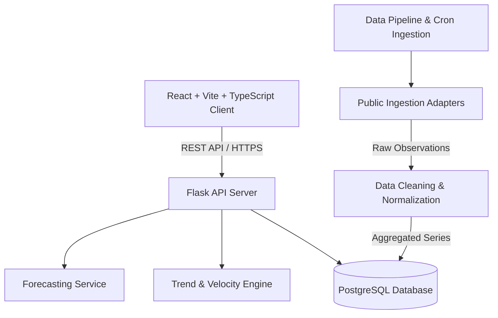

# TrendTide — Technical Design Report (TDR)
**Version:** 1.0.0-Draft (Phase 0/1)  
**Author:** Antigravity AI & Piyush  
**Date:** October 2026  

---

## 1. System Architecture
TrendTide adopts a decoupled service architecture separating presentation, REST API services, batch data pipelines, analytics computation, and persistence.

## 2. Mathematical Rigor & Feature Formulation

### 2.1 Velocity Calculation ($V_t$)
$$V_t = \frac{\bar{Y}_{t, 7} - \bar{Y}_{t-7, 7}}{\bar{Y}_{t-7, 7} + \delta}$$
where $\bar{Y}_{t, 7}$ is the 7-day trailing simple or exponential moving average and $\delta = 10^{-4}$ stabilizes division for low initial counts.

### 2.2 Relative Acceleration ($A_t$)
$$A_t = V_t - V_{t-7}$$
A positive $A_t$ reveals acceleration—the core signal for "Catching a Trend Before It Peaks".

### 2.3 Spike vs. Trend Discrimination
We define the **Signal Sustainability Metric** $S_t$:
$$S_t = \frac{\text{Median}(Y_{t-14:t})}{\text{Max}(Y_{t-14:t})}$$
- If $S_t < 0.15$ with a single isolated maximum, the event is classified as an **Ephemeral Spike**.
- If $S_t \ge 0.40$ and the slope of the 14-day linear fit is positive ($m > 0$), it is categorized as a **Sustained Emerging Trend**.

## 3. Frontend Architecture (Phase 1)
- **Framework:** React 18, Vite 5, TypeScript 5.
- **Styling:** Tailwind CSS with custom navy tokens (`#0f172a`, `#1e293b`, `#3b82f6`).
- **State Management:** React Context + hooks for authentication and local storage for saved watchlist items.
- **Visualizations:** Native responsive SVG charts with animated path transitions, grid guidelines, hover tooltips, and uncertainty envelope rendering.

## 4. Verification & Testing Regimen
- Static type checking with `tsc --noEmit`.
- Production bundle validation with `vite build`.
- 100% route accessibility and fallback resolution for unauthorized (403) and 404 paths.
